
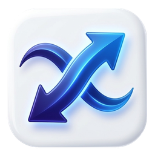

<h1 align="center">FastShare – Fast File Transfer for Android &amp; Windows</h1>

Send photos, videos, apps, music, documents and whole folders between phones and PCs — directly, over Wi-Fi, with no internet, no cable and no account. 
A free, light alternative to SHAREit, Xender and LocalSend.

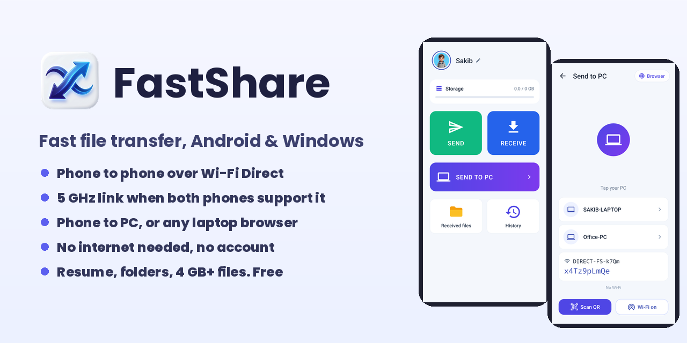

## Download

| Platform | File | Notes |
|---|---|---|
| **Android** 7.0+ | **[⬇️ FastShare.apk](https://github.com/simplefysakib/FastShare---Fast-File-Transfer/releases/latest/download/FastShare.apk)** | Install, allow "Install unknown apps" if your phone asks. Updates install over the old version. |
| **Windows** 64-bit | **[⬇️ FastShare_Windows_Setup.exe](https://github.com/simplefysakib/FastShare---Fast-File-Transfer/releases/latest/download/FastShare_Windows_Setup.exe)** | Recommended. No admin rights needed. |
| **Windows** 64-bit, portable | [FastShare_Windows_Portable.zip](https://github.com/simplefysakib/FastShare---Fast-File-Transfer/releases/latest/download/FastShare_Windows_Portable.zip) | Unzip and run `FastShare.exe`. Nothing is installed. |
| **Windows** 32-bit | [FastShare_Windows_32bit_Setup.exe](https://github.com/simplefysakib/FastShare---Fast-File-Transfer/releases/latest/download/FastShare_Windows_32bit_Setup.exe) | For older 32-bit PCs. |

All files are on the **[latest release](https://github.com/simplefysakib/FastShare---Fast-File-Transfer/releases/latest)** page, with their SHA-256 checksums. Website: **[simplefysakib.github.io/FastShare---Fast-File-Transfer](https://simplefysakib.github.io/FastShare---Fast-File-Transfer/)**

> **"Windows protected your PC"?** FastShare is new and not yet known to Microsoft SmartScreen. Click **More info → Run anyway**.

## Screenshots

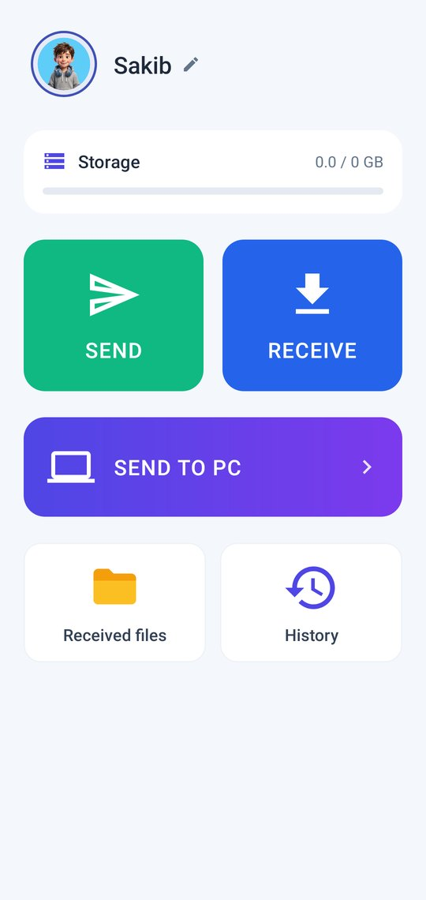
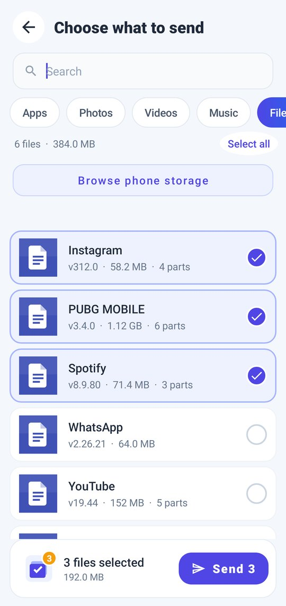
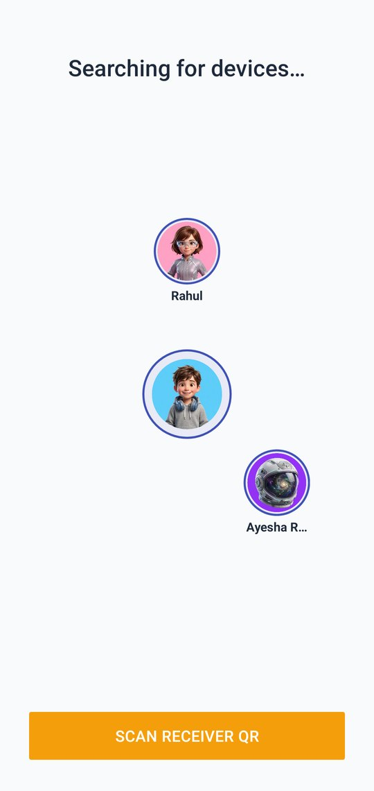

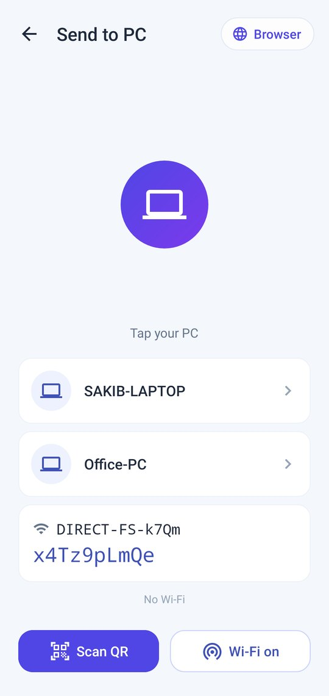
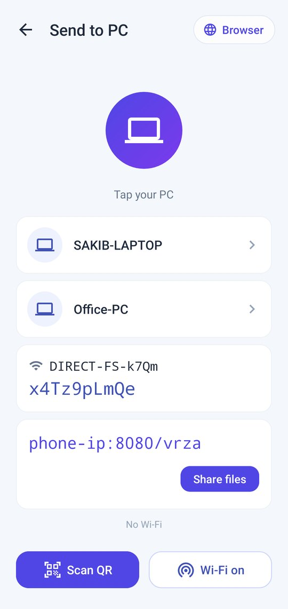
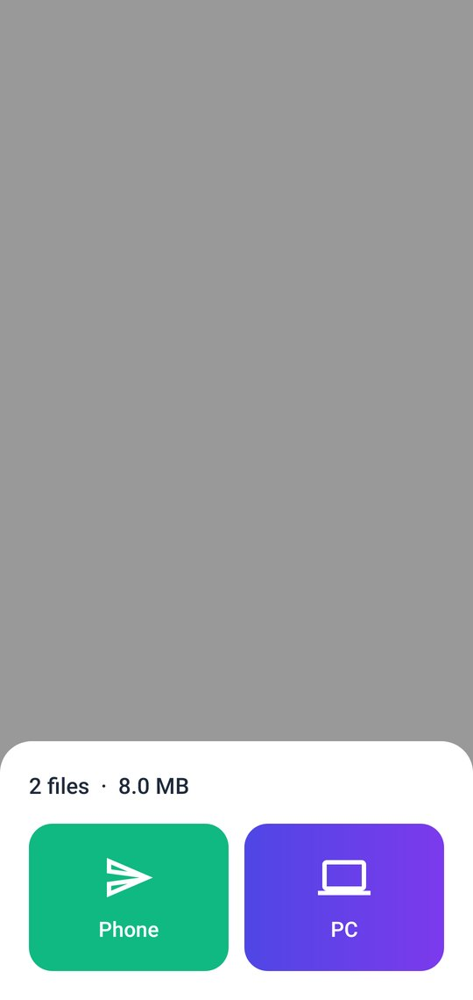
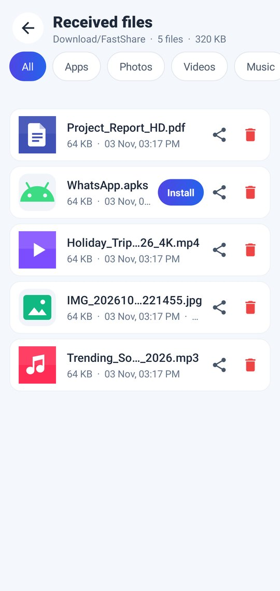

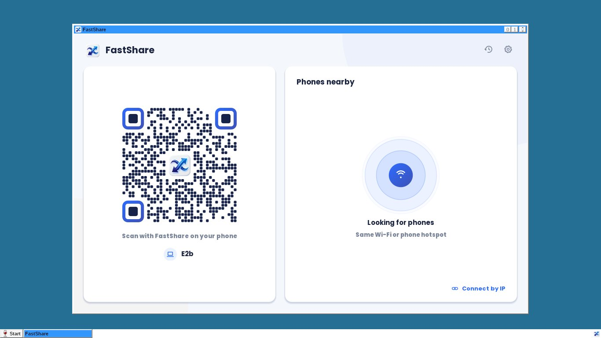
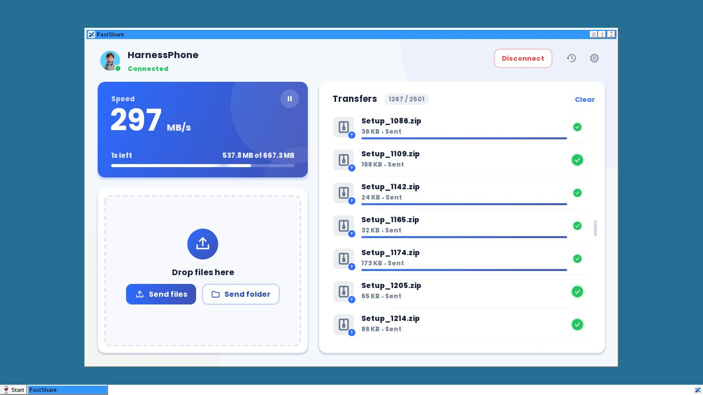

## Features

- **Phone to phone over Wi-Fi Direct** – the phones talk to each other directly, no router and no internet in between. When both phones support 5 GHz, FastShare opens a 5 GHz link automatically; otherwise it uses 2.4 GHz without getting stuck.
- **Send to PC, both ways** – phone → PC and PC → phone with the free Windows app. PCs on the same Wi-Fi show up automatically, or scan a QR code.
- **Browser mode** – a laptop without the app (Windows, Mac, Linux, Chromebook) opens an address shown on the phone in any web browser to download and upload files.
- **Share from any app** – pick FastShare in Android's share menu (Gallery, File manager, WhatsApp media…) and send to a phone or PC.
- **Resume** – if a transfer is cut (Wi-Fi drop, app closed), it continues from where it stopped instead of starting again.
- **Big files and folders** – files over 4 GB, whole folders with their structure, and hundreds of small files in one go.
- **Real live speed** – the speed you see is the speed you get, measured live, together with the Wi-Fi band in use (5 GHz / 2.4 GHz). No fake numbers.
- **Light, clean design** – a few big buttons: Send, Receive, Send to PC.
- **Free** – no account, no sign-up, no file size limit.

## How fast is it? (honest numbers)

A direct phone-to-phone transfer can never be faster than the Wi-Fi radios in the two phones. FastShare picks the fastest link both phones support and keeps the CPU out of the way, so each phone gets close to its hardware limit. Typical real-world speeds:

| Your phones | Wi-Fi link | Typical speed |
|---|---|---|
| Either phone has 2.4 GHz-only Wi-Fi (many budget phones) | 2.4 GHz, Wi-Fi 4 | **≈ 5–12 MB/s** |
| Both phones have 5 GHz Wi-Fi 5 (802.11ac) | 5 GHz | **≈ 20–40 MB/s** |
| Both phones have Wi-Fi 6, held close together | 5 GHz, Wi-Fi 6 | **40+ MB/s** |
| Phone ↔ PC on a home router | depends on the router and the PC | varies |

Speeds depend on the phones, distance, walls and Wi-Fi interference. The speed shown in the app is always the real measured speed.

## How to use

**Phone → phone**
1. Install FastShare on both phones.
2. On the receiving phone tap **Receive**.
3. On the sending phone tap **Send**, pick files, then tap the receiver's name (or scan its QR code).

**Phone ↔ PC (Windows app)**
1. Install FastShare on the PC and open it. Keep phone and PC on the same Wi-Fi.
2. On the phone tap **Send to PC** and tap your PC's name — or scan the QR code shown on the PC.
3. Send files either way.

**Phone → any laptop (no app)**
1. On the phone tap **Send to PC → Browser**.
2. On the laptop, join the same Wi-Fi (or the Wi-Fi name the phone shows) and open the address shown on the phone in any browser.
3. Download or upload files right in the browser.

## Requirements

- **Android:** 7.0 (Nougat) or newer. Wi-Fi Direct capable phone (almost all are). 5 GHz speeds need 5 GHz Wi-Fi on both phones.
- **Windows:** Windows 7 SP1, 8.1, 10 or 11 — 64-bit (Setup or Portable) or 32-bit (32-bit Setup). Everything it needs is included; nothing else to install.
- Permissions on Android: storage/media (to read and save files), nearby devices / location (Android needs these to open a Wi-Fi Direct link), camera (only to scan QR codes), notifications (to show transfer progress).

## Privacy

- **No account and no sign-up.**
- **Your files never go to a server.** They travel directly from one device to the other over your local Wi-Fi / Wi-Fi Direct link. The internet is not used for transfers.
- The Android app is free and shows ads (Unity Ads); the ad SDK uses the internet and may use your phone's advertising ID. The Windows app has no ads.

## FAQ

**Does it need internet or mobile data?**  
No. Transfers run over a direct Wi-Fi link between the devices. Mobile data is never used for your files.

**Why is my transfer only around 5–10 MB/s?**  
At least one of the phones is on 2.4 GHz Wi-Fi (many budget phones only have 2.4 GHz). That is the radio's limit, not the app's. With two 5 GHz phones the same transfer runs several times faster.

**Can I send files bigger than 4 GB?**  
Yes. Large videos, backups and whole folders work, and an interrupted transfer resumes where it stopped.

**My laptop doesn't have FastShare. Can I still send files?**  
Yes — use **Browser mode** (Send to PC → Browser) and open the shown address in any browser on the laptop.

**Is it on the Play Store?**  
Not yet. Download the APK from the [latest release](https://github.com/simplefysakib/FastShare---Fast-File-Transfer/releases/latest). New versions install over the old one.

**Is FastShare open source?**  
No. FastShare is free to download and use (freeware); this repository hosts the official builds and release notes.

**Where do I report a bug or ask for a feature?**  
Open an [issue](https://github.com/simplefysakib/FastShare---Fast-File-Transfer/issues).

## License and disclaimer

FastShare is **freeware** © 2026 Sakib (simplefysakib). You may download, use and share unmodified copies for free. See [LICENSE](LICENSE). The software is provided "as is", without warranty of any kind.

FastShare is an independent app and is not affiliated with SHAREit, Xender, LocalSend, Google, Microsoft or any other company. Product names are trademarks of their respective owners and are mentioned only for comparison.
